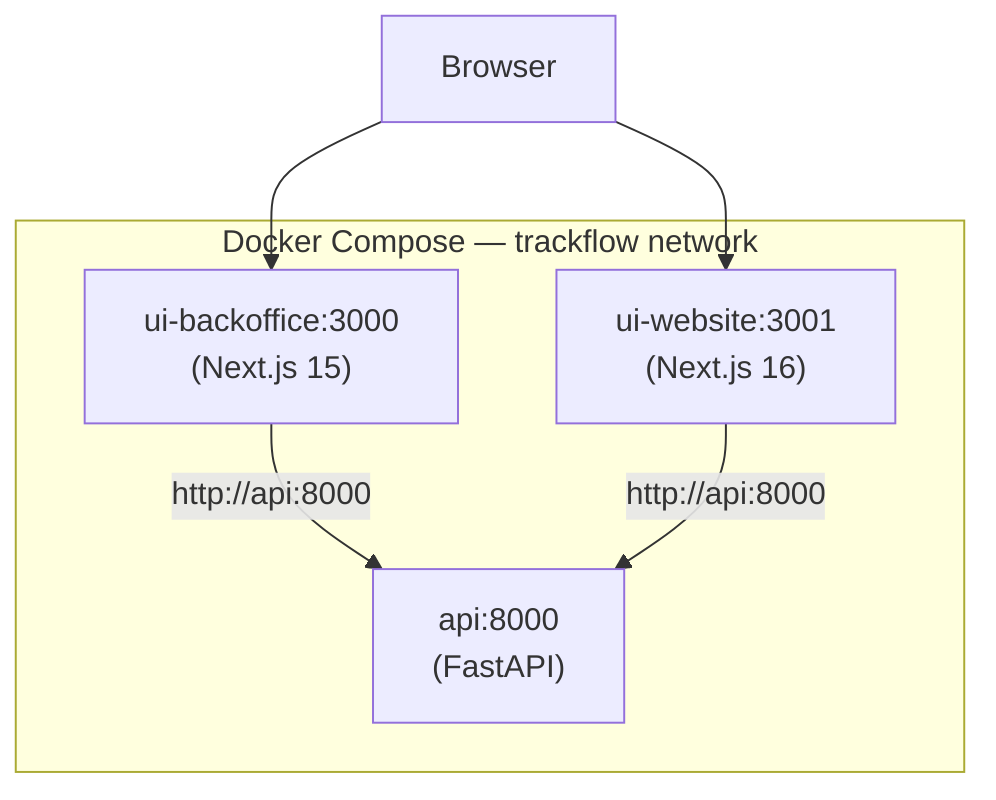

# AI Engineering Company Project — Student Template

[](https://4geeksacademy.com)
[](https://4geeksacademy.com/es/programas-de-carrera/ingenieria-ia)

_Base template for transversal projects in the AI Engineering Career Program — 4Geeks Academy._

> _Instrucciones disponibles en español en [README.es.md](./README.es.md)._

---

## Purpose

This repository is the **starter template** for transversal projects. You will work on real company scenarios (Brasaland, TrackFlow, Nexova), building deliverables that map to course milestones (Web, Programming, Backend, Telemetry, RAG, Agents, Workflows, Real-time).

- **Create a template** from this repo (do not clone the milestone-specific one).
- Read your **CONTEXT** file for your assigned company — it defines domain data, fields, and constraints.
- Use the **skills/** folder so AI agents can assist you consistently.

---

## Repository structure

```text
ai-engineering-project-template/
├── README.md                 # This file
├── AGENTS.md                 # Index for AI agents: which skills exist and when to use them (you will add it in the future)
├── CONTEXT.md                # Your company context (Brasaland | TrackFlow | Nexova) — add after assignment
├── apps/                     # Your applications (web app, API, dashboards)
├── packages/
│   └── shared-types/         # Shared TypeScript/JSON types used across apps
├── pipelines/
│   └── data/                 # ETL, ingestion, or data pipeline configs/scripts
└── skills/                   # Agent skills (SKILL.md + optional examples, scripts, templates)
    ├── research/
    ├── data-analysis/
    ├── web-scraping/
    ├── code-review/
    └── math-reasoning/
```

---

## How to start

1. **Fork** this repository to your GitHub account.
2. **Clone** your fork (or open in GitHub Codespaces).
3. **Add your CONTEXT**: copy the `CONTEXT-<company>.md` for your assigned company into the root as `CONTEXT.md`.
4. **Read** `AGENTS.md` so you know which skills are available when working with AI.
5. **Build** your milestone deliverables inside `apps/`, reusing `packages/shared-types` and `pipelines/data` as needed.

---

## Milestones (reference)

| Milestone | Focus        | Typical deliverables                        |
| --------- | ------------ | ------------------------------------------- |
| 0         | Prework      | Environment setup, first prompts            |
| 1         | Web          | Corporate website, forms, SEO               |
| 2         | Programming  | Business logic, scoring, calculations       |
| 3         | AI-driven UI | AI-generated interfaces                     |
| 4         | Next.js      | Portals, loyalty app, operations UI         |
| 5         | Backend      | Central API (locations, menus, sales, etc.) |
| 6         | Telemetry    | Data pipeline, dashboards                   |
| 7         | RAG & Memory | Semantic knowledge base, search             |
| 8         | Agents       | Support, onboarding, training agents        |
| 9         | Workflows    | n8n automations                             |
| 10        | Real-time    | Live dashboards, alerts, streaming          |

---

## Docker Development (INFRA-40)

The entire monorepo can be run with Docker Compose for consistent development environments
and production deployment to a VPS.

### Quick Start (Development)

```bash
# 1. Create environment (SQLite — no external Postgres needed)
cp .env.docker .env

# 2. Build and start all services
docker compose up --build

# 3. Open in browser
#    Backoffice: http://localhost:3000
#    Website:    http://localhost:3001
#    API health: http://localhost:8000/health
```

Three services start:
| Service       | Container          | Port  | Tech              | Hot reload |
|---------------|--------------------|-------|--------------------|------------|
| API           | `trackflow-api`    | 8000  | FastAPI + uvicorn  | ✅ `--reload` |
| Backoffice    | `trackflow-backoffice` | 3000  | Next.js 15         | ✅ dev server |
| Public website | `trackflow-website` | 3001  | Next.js 16         | ✅ dev server |

All source directories are bind-mounted for instant edit-refresh. `node_modules`
and `.venv` are preserved via anonymous Docker volumes so the host OS does not
shadow Linux-compiled binaries.

### Production Deployment (VPS)

```bash
# On your VPS:
git clone <repo-url> /opt/trackflow
cd /opt/trackflow

# Configure with real production secrets
cp .env.docker .env
# Edit .env:
#   - JWT_SECRET_KEY (run: openssl rand -hex 32)
#   - DATABASE_URL   (real Supabase Postgres URL)
#   - RESEND_API_KEY / RESEND_FROM_EMAIL
#   - NEXT_PUBLIC_INCIDENTS_API_BASE_URL (public domain or IP)
#   - NEXT_PUBLIC_INVENTORY_API_URL (public domain or IP)

# Deploy
bash scripts/deploy.sh
```

Or manually:

```bash
docker compose -f docker-compose.yml -f docker-compose.prod.yml up -d --build
```

The production overlay:
- Removes all bind-mounts (self-contained images)
- Runs `npm run build && npm run start` (Next.js standalone server)
- Uses `restart: always` for resilience
- Disables uvicorn `--reload`

### Architecture



The UI containers resolve the API via the Docker DNS name `api` (not `localhost`),
enabling inter-container communication without host networking.

### Files Created

| File | Purpose |
|------|---------|
| `uis/Dockerfile` | Node.js 22 image for both Next.js apps |
| `uis/.dockerignore` | Excludes node_modules/.next from build context |
| `services/Dockerfile` | Python 3.12 slim image for FastAPI |
| `services/.dockerignore` | Excludes __pycache__/data/.venv |
| `docker-compose.yml` | Dev compose: bind-mounts, reload, healthcheck |
| `docker-compose.prod.yml` | Prod overlay: no mounts, build+start, always restart |
| `.env.docker` | Ready-to-use dev environment (SQLite, dummy secrets) |
| `.dockerignore` | Root-level context filter |
| `scripts/deploy.sh` | One-command VPS deploy |

---

## Links

- [4Geeks Academy — AI Engineering](https://4geeksacademy.com/es/programas-de-carrera/ingenieria-ia)
- [How to start a coding project](https://4geeks.com/lesson/how-to-start-a-project)

---

## Contributors

This template was built as part of the 4Geeks Academy AI Engineering Career Program by [@marcogonzalo](https://www.linkedin.com/in/marcogonzalo) and [@alezanchezr](https://x.com/alesanchezr) and many other contributors. Find out more about our [AI Engineering Course](https://4geeksacademy.com/en/career-programs/ai-engineering), and [other courses](https://4geeksacademy.com/en/program-comparison).

You can find other templates and resources like this at the [4Geeks Academy GitHub page](https://github.com/4geeksacademy).

_This template is maintained by 4Geeks Academy for the AI Engineering track. For exclusive use in the programme._
