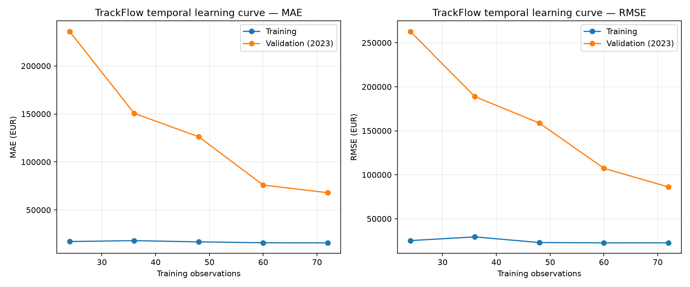
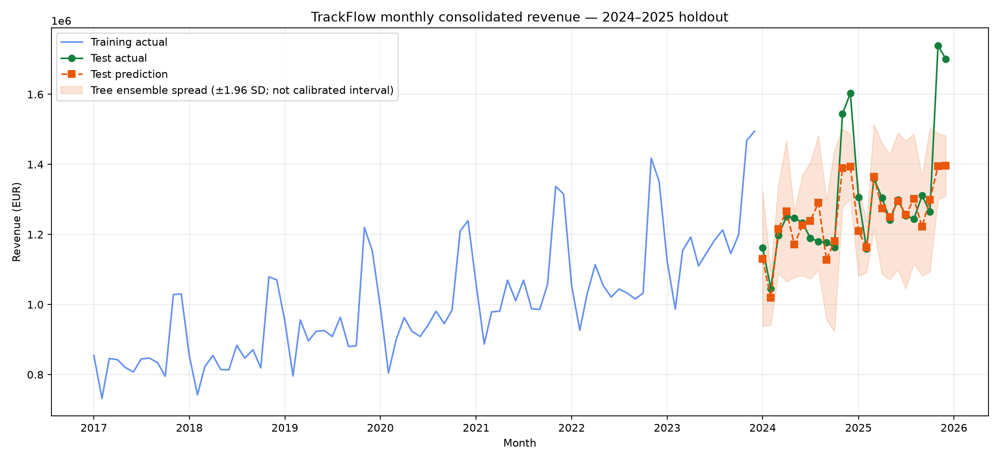

# TrackFlow monthly sales regression — technical evaluation

## Executive decision

**Diagnosis: overfitting.** The forward-chaining learning curve ends with training RMSE €22,659 versus 2023 validation RMSE €86,088 (gap €63,428; 73.7% of validation RMSE). Five-fold temporal CV validation RMSE is €78,881 ± €10,739; this indicates overfitting for the available synthetic history.

**Specific action:** Regularize the Random Forest before promotion: reduce max_depth from 8 to 4 and raise min_samples_leaf from 3 to 6, then rerun the identical forward-chaining CV and compare validation RMSE. This targets the observed train/validation gap.

## Data and leakage controls

Target is `revenue_eur` from the `consolidated` market row. The 2016-01–2023-12 period is training and 2024-01–2025-12 is the untouched 24-month holdout. Twelve early rows are unavailable to modeling because the 12-month lag/rolling history is required; thus the feature matrix contains 84 training and 24 test observations. No current-month revenue, shipments, or revenue-per-shipment values enter predictors. All lags and rolling means are shifted so month t uses only observations through t-1. Folds are expanding-window `TimeSeriesSplit` with five 12-month validation windows; model fitting occurs separately inside every fold. At validation starts, earlier observed months remain valid causal context for one-month-ahead predictions.

## Time-aware cross-validation

| Fold | Training period | Validation period | Validation MAE | Validation RMSE |
|---:|---|---|---:|---:|
| 1 | 2017-01–2018-12 (24 rows) | 2019-01–2019-12 | €71,233 | €89,401 |
| 2 | 2017-01–2019-12 (36 rows) | 2020-01–2020-12 | €49,507 | €65,228 |
| 3 | 2017-01–2020-12 (48 rows) | 2021-01–2021-12 | €63,795 | €84,054 |
| 4 | 2017-01–2021-12 (60 rows) | 2022-01–2022-12 | €47,908 | €69,632 |
| 5 | 2017-01–2022-12 (72 rows) | 2023-01–2023-12 | €67,990 | €86,088 |

Validation MAE: **€60,087 ± €10,732** (mean ± sample SD). Validation RMSE: **€78,881 ± €10,739**. Fold training MAE: €16,717 ± €961; training RMSE: €24,559 ± €2,899.

All training indices precede their validation indices; validation windows move forward without overlap or shuffling. The tests assert the ordering contract. Feature engineering is causal once on the chronological series; this does not expose a validation target because each feature uses only earlier values. No scaler or other full-data learned transform is applied.

## Learning curve

The curve uses expanding chronological prefixes and a fixed 2023 validation year; the validation year is never used to fit any plotted model. Training MAE/RMSE are in-sample fit metrics; validation metrics measure the later year.

| Training observations | Training RMSE | 2023 validation RMSE |
|---:|---:|---:|
| 24 | €25,165 | €262,915 |
| 36 | €29,388 | €188,821 |
| 48 | €22,960 | €158,711 |
| 60 | €22,621 | €107,326 |
| 72 | €22,659 | €86,088 |

## Metric choice and 2024–2025 holdout

MAE is the primary business metric: each euro of absolute miss has a direct interpretation for revenue planning and it is not dominated by a few unusually high Black Friday/holiday months. RMSE is reported alongside it because its stronger penalty for large misses is useful when peak-season forecast errors can affect warehouse and carrier capacity. The briefing does not establish whether over- or underestimation has a higher asymmetric cost, so neither direction is assigned extra weight.

- Training (2017-01–2023-12, 84 modeled months): MAE **€15,761**, RMSE **€22,385**.
- Holdout (2024-01–2025-12, 24 months): MAE **€72,751**, RMSE **€116,872**.
- Holdout MSE: **€13,658,975,278 EUR²**; RMSE is **9.00%** of mean holdout monthly revenue (€1,299,073). For completeness, the dimensionally unusual MSE/average-revenue ratio is 1051440.12% (EUR² divided by EUR).
- Revenue-rank Gini: **0.736**; K2 (Kuiper two-sample distribution statistic): **0.250**.
- Country-mix PSI: **N/A**. The provided CSV has only consolidated rows and no US/Spain shipment split; computing a country volume-mix PSI from it would be unsupported. The provided shipment and average-revenue fields are lagged as inputs, not country-level proportions.

The shaded region is ±1.96 times the across-tree prediction standard deviation. It is an ensemble spread visualization, not a statistically calibrated 95% prediction interval.

## Stability and limitations

Five chronological validation RMSEs range from €65,228 to €89,401; see mean ± SD above for performance sensitivity to the training window. These results are a feasibility evaluation on deterministic synthetic sales history, not evidence of future real-world performance. A holdout spanning increasing annual revenue tests extrapolation beyond the Random Forest's learned target range; the CV scores should therefore be read together with the fixed 2024–2025 holdout rather than as a deployment guarantee.
