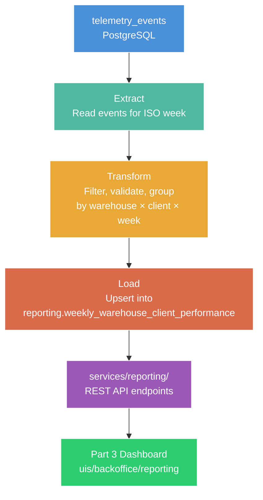

# Pipeline Design — Weekly Warehouse & Client Performance Report

## Current State

### Telemetry Events Captured

TrackFlow's telemetry system captures the following event types in the `telemetry_events` table (PostgreSQL, schema `public`):

| `event_type`                  | Description                                                                  |
| ----------------------------- | ---------------------------------------------------------------------------- |
| `inbound_order_created`       | A warehouse registers receipt of goods from a client                          |
| `outbound_order_created`      | A warehouse completes picking and dispatch of an order                        |
| `stock_threshold_triggered`   | A SKU's stock falls below the configured minimum for that client              |
| `direct_stock_edit_rejected`  | A user attempts to modify stock directly (outside an order) and is rejected   |
| `inventory_discrepancy_detected` | A physical count or audit detects a difference between system and actual stock |
| `inventory_validation_failed` | An inventory operation fails validation                                       |
| `inventory_products_viewed`   | A user views inventory products                                               |
| `login_succeeded` / `login_failed` / `session_expired` | Authentication events                    |
| `navigation_page_viewed`      | Page navigation events                                                        |
| `flow_abandoned`              | A multi-step flow is abandoned mid-way                                       |
| `api_latency_recorded`        | API latency measurement event                                                 |
| `frontend_error_captured`     | Frontend error capture                                                        |
| `web_vital_recorded`          | Web performance vitals                                                        |
| `supplier_action_completed`   | Supplier CRUD actions                                                         |
| `incident_action_completed`   | Incident lifecycle actions                                                    |

### Storage

All events are stored in `public.telemetry_events` with the following schema:

```sql
event_id UUID PRIMARY KEY,
event_type VARCHAR NOT NULL,
event_timestamp TIMESTAMPTZ NOT NULL,
properties JSONB NOT NULL,
session_id UUID,
user_id UUID,
schema_version TEXT NOT NULL,
request_id UUID NOT NULL
```

Key indexes exist on `event_type`, `event_timestamp DESC`, and a GIN index on `properties`.

### Existing Technical Report (`GET /telemetry/report`)

The existing technical report (`services/telemetry/analysis.py` exposed via `GET /telemetry/report`) produces three categories of operational metrics for the engineering team:

1. **Events per day** — volume of all event types grouped by UTC day, revealing activity or ingestion gaps.
2. **API error rate by day** — ratio of HTTP ≥400 responses from `api_latency_recorded` events, grouped by day.
3. **API latency by day and route** — mean and p95 latency per safe API route, grouped by day.

**Audience:** Engineering team (Andrés Kim, CTO) — technical, debugging-oriented.
**Granularity:** Time-series of technical signals per day.
**Output location:** `GET /telemetry/report` endpoint in `services/telemetry/`.

### The Gap

The existing technical report answers:

- *How many events are we receiving?* (volume)
- *Is the API reliable?* (error rates)
- *Is the API fast enough?* (latency)

It does **not** answer the business question Thomas (CEO) and Ana (Head of Warehouse Operations) need:

- *How much inventory came in this week per warehouse per client?* (Inbound Volume)
- *How many orders did each warehouse process for each client?* (Outbound Throughput)
- *How often did a client's SKU run low on stock?* (Stockout Frequency)
- *How accurate is our inventory per warehouse per client?* (Discrepancy Rate)

These are fundamentally different questions for a different audience — business leadership, not engineering. They require weekly aggregation at the warehouse × client grain, and they cannot be answered by the technical report.

---

## Pipeline Purpose

**Produce the weekly, per-warehouse, per-client rollup of throughput, stockout activity, and inventory accuracy — the "Weekly Warehouse & Client Performance Report" — that Thomas (CEO) can open Monday morning without calling Ana or Miguel.**

**KPIs computed** (from the company-BRIEFING.md KPIs to Measure section):

| KPI                     | Definition                                                                                     |
| ----------------------- | ---------------------------------------------------------------------------------------------- |
| Inbound Volume          | Sum of `quantity` from `inbound_order_created` events for the week                             |
| Outbound Throughput     | Count of `outbound_order_created` events for the week                                          |
| Stockout Frequency      | Count of `stock_threshold_triggered` events for the week                                       |
| Discrepancy Rate        | `count(inventory_discrepancy_detected) / count(outbound_order_created)` for the week (0 if no outbound orders) |

**Mandatory metrics it consumes** (from telemetry BRIEFING):

- `inbound_order_created` (feeds Inbound Volume)
- `outbound_order_created` (feeds Outbound Throughput + Discrepancy Rate denominator)
- `stock_threshold_triggered` (feeds Stockout Frequency)
- `inventory_discrepancy_detected` (feeds Discrepancy Rate numerator)

**Cadence:** Weekly — computed and available fresh Monday morning UTC.

**Audience:** Thomas (CEO) and Ana (Head of Warehouse Operations) — non-technical stakeholders.

---

## Extraction Format

### Source

The pipeline reads **only** from `public.telemetry_events` (read-only). It never writes back to this table.

### Format

Each relevant event arrives as a row in `telemetry_events` with:

- `event_type`: one of the four mandatory types
- `event_timestamp`: TIMESTAMPTZ — when the event occurred
- `properties`: JSONB containing at minimum:
  - `warehouse` (`los_angeles` / `zaragoza`)
  - `client_id` (text)
  - `product_id` (text — the SKU)
  - `product_category` (text)
  - `quantity` (integer)

### Update Cadence

Events are written in real-time by the telemetry capture endpoint (`POST /api/telemetry/events`). The pipeline extracts data for the completed ISO week (Monday 00:00:00 UTC through Sunday 23:59:59 UTC).

Typical pipeline run: **Monday 01:00 UTC** (one hour after the week closes, allowing for clock skew and late-arriving events).

---

## Data Flow



### Stage 1: Extraction

**What:** Query `telemetry_events` for the target ISO week, filtering to the four mandatory event types:
- `inbound_order_created`
- `outbound_order_created`
- `stock_threshold_triggered`
- `inventory_discrepancy_detected`

**Output:** A DataFrame/record set with columns: `event_id`, `event_type`, `event_timestamp`, `properties` (as structured JSON), `warehouse`, `client_id`, `quantity`.

**Boundary:** The extraction window is `[week_start_monday, week_start_monday + INTERVAL '7 days')` — a half-open interval. The `week_start` is computed from `event_timestamp` using ISO week logic (Monday of that week, UTC).

**Duplicate handling at extraction:** Use a cursor/offset or WHERE clause on `event_timestamp` rather than reading the entire table. Extract only the columns needed — no `SELECT *`.

### Stage 2: Transformation

**What:** For each row, derive:
- The ISO `week_start` (Monday UTC) from `event_timestamp`
- Flatten `properties` JSONB to access `warehouse`, `client_id`, `product_id`, `product_category`, `quantity`
- Filter out any events with missing required fields or invalid warehouse/client values
- Group by (`warehouse`, `client_id`, `week_start`) and compute:
  - `inbound_units_count` = SUM(`quantity`) WHERE `event_type = 'inbound_order_created'`
  - `outbound_orders_count` = COUNT(*) WHERE `event_type = 'outbound_order_created'`
  - `stockout_events_count` = COUNT(*) WHERE `event_type = 'stock_threshold_triggered'`
  - `discrepancy_events_count` = COUNT(*) WHERE `event_type = 'inventory_discrepancy_detected'`
  - `discrepancy_rate` = `discrepancy_events_count / outbound_orders_count` (0 if `outbound_orders_count = 0`)

**Output:** One row per (`warehouse`, `client_id`, `week_start`) ready for load.

### Stage 3: Load

**What:** For each computed row, upsert into `reporting.weekly_warehouse_client_performance`.

**Idempotency mechanism:** Use the table's `UNIQUE (warehouse, client_id, week_start)` constraint with an upsert:

```sql
INSERT INTO reporting.weekly_warehouse_client_performance
    (warehouse, client_id, week_start, inbound_units_count, outbound_orders_count,
     stockout_events_count, discrepancy_events_count, discrepancy_rate, computed_at)
VALUES (:warehouse, :client_id, :week_start, :inbound_units, :outbound_orders,
        :stockout_events, :discrepancy_events, :discrepancy_rate, NOW())
ON CONFLICT (warehouse, client_id, week_start)
DO UPDATE SET
    inbound_units_count = EXCLUDED.inbound_units_count,
    outbound_orders_count = EXCLUDED.outbound_orders_count,
    stockout_events_count = EXCLUDED.stockout_events_count,
    discrepancy_events_count = EXCLUDED.discrepancy_events_count,
    discrepancy_rate = EXCLUDED.discrepancy_rate,
    computed_at = NOW();
```

This guarantees that re-running the pipeline over the same week produces identical results — not duplicates.

---

## Destination

### Table

```sql
CREATE TABLE IF NOT EXISTS reporting.weekly_warehouse_client_performance (
  id uuid primary key default gen_random_uuid(),
  warehouse text not null,
  client_id text not null,
  week_start date not null,
  inbound_units_count integer not null default 0,
  outbound_orders_count integer not null default 0,
  stockout_events_count integer not null default 0,
  discrepancy_events_count integer not null default 0,
  discrepancy_rate numeric not null default 0,
  computed_at timestamptz not null default now(),
  unique (warehouse, client_id, week_start)
);
```

### Reporting Endpoints (in `services/reporting/`)

| Method | Path                                          | Purpose                                              |
| ------ | --------------------------------------------- | ---------------------------------------------------- |
| `GET`  | `/reporting/weekly-warehouse-client-performance` | Returns KPI rows for a given week (defaults to latest) |
| `GET`  | `/reporting/pipeline-runs/latest`             | Status and metadata of the last pipeline run           |
| `POST` | `/reporting/pipeline-runs`                    | Triggers a manual pipeline run                         |

These endpoints are in a **new** `services/reporting/` module, separate from `services/telemetry/` and the `GET /telemetry/report` endpoint. They import pipeline logic from `data/pipelines/`.

---

## Handling Updates to Existing Records

### Strategy for late-arriving events

Events may arrive after the initial pipeline run for a given week (e.g., due to network delays, offline buffering, or clock skew). The design handles this through **idempotent upserts**:

1. The pipeline can be re-run for any past week — just supply the `week_start` parameter.
2. The upsert (`ON CONFLICT ... DO UPDATE`) replaces the existing row with recomputed values based on all events in that week's window.
3. The `computed_at` timestamp is updated to reflect the most recent computation, providing an audit trail of when the data was last refreshed.

### Avoiding duplicates at the source

Within `telemetry_events`, deduplication is handled by the `event_id` (UUID) primary key — the telemetry capture does `ON CONFLICT (event_id) DO NOTHING`. The pipeline therefore never sees duplicate events for the same event_id.

However, if the pipeline itself is re-run (e.g., after failure), it re-reads all events in the week window and recomputes — the upsert guarantees no duplicate destination rows.

---

## Resilience and Idempotency

### Idempotency Strategy

If the pipeline fails during the **load** phase with partial data already inserted:

1. **First run (failure):** Some rows were written to `reporting.weekly_warehouse_client_performance` before the connection dropped.
2. **Second run (retry):** The pipeline re-extracts all events for the same week window (no "already processed" watermark), re-transforms, and re-inserts using `ON CONFLICT ... DO UPDATE`.
3. **Result:** The already-inserted rows are overwritten with the recomputed values. No duplicates, no corruption. The final state is identical to what a clean single run would have produced.

**Key design choice:** The pipeline does **not** use a "last processed event_id" watermark. Instead, it uses the **week window** as its atomic unit of work. This means:
- Every run for a given week is a full recompute — simple, auditable, and immune to gaps caused by partially processed batches.
- The cost is acceptable because the weekly volume is modest (thousands of events, not billions).

### Execution Log

Every pipeline run records the following fields (stored in `reporting.pipeline_runs` table or equivalent structured log):

| Field                 | Type        | Purpose                                                                                    |
| --------------------- | ----------- | ------------------------------------------------------------------------------------------ |
| `run_id`              | UUID (PK)   | Uniquely identifies each run for auditing and cross-referencing                             |
| `week_start`          | DATE        | The ISO week being processed — enables per-week audit trail                                |
| `started_at`          | TIMESTAMPTZ | When the pipeline run started — used to detect stalls and measure duration                  |
| `completed_at`        | TIMESTAMPTZ | When the pipeline run finished (NULL if still running or failed)                            |
| `status`              | TEXT        | `running`, `completed`, `failed`, `partial` — current state of the run                     |
| `records_extracted`   | INTEGER     | Number of source events read — detects volume anomalies (zero = possible ingestion outage)  |
| `records_loaded`      | INTEGER     | Number of destination rows upserted — confirms data reached the reporting table             |
| `error_message`       | TEXT        | Captured error details if the run failed — enables debugging without log access             |
| `triggered_by`        | TEXT        | `scheduler` or `manual` or `startup` — distinguishes automated runs from manual triggers    |

These nine fields provide:
- **Observability** — know when a run started, finished, how long it took, and how many records it touched.
- **Failure detection** — a run stuck in `running` for >1 hour signals a stall. A `failed` status with error_message enables root-cause analysis.
- **Volume anomaly detection** — zero records_extracted when 500 are expected on Monday morning flags a potential ingestion failure.
- **Audit trail** — each week's runs are fully traceable with timestamps and trigger source.

### Recoverability

If the database connection drops mid-pipeline:

1. The Prefect task retries (3 retries with 30-second delays as configured).
2. If all retries fail, the flow enters a `Failed` state with the error captured.
3. On the next scheduled run (or manual trigger), the pipeline starts fresh for the target week.
4. Because the upsert is idempotent, any partially loaded rows from the failed run are overwritten.
5. The execution log records the failure with status=`failed` and the error message, preserving the audit trail.

### Late Events Handling

Late-arriving events (events whose `event_timestamp` falls in an already-computed week) are handled by re-running the pipeline for that specific week:

- The `GET /reporting/pipeline-runs` endpoint accepts an optional `week_start` parameter to trigger a targeted recompute.
- The upsert replaces the old aggregated row with the new one that includes the late event.
- No manual intervention is needed — the pipeline is designed to be re-run for any past week without side effects.

### Silence vs. True Absence

The pipeline records `records_extracted` in the execution log. If the count is zero and the week is expected to have data:

- A zero row count combined with a `completed` status signals the pipeline ran but found no events — this could be a true absence (e.g., warehouse closed for holiday) or a data ingestion failure.
- A `failed` or never-`completed` status signals a pipeline or upstream problem.
- Monitoring alerts on `records_extracted = 0` for known-busy weeks provide an early warning system.

### Concurrent Runs Prevention

- The pipeline uses a **run lock** based on the `week_start`: if a run for that week is already in `running` status, a second run for the same week is rejected.
- Cross-week runs (e.g., week 27 and week 28) can run concurrently without conflict.
- In Prefect, the flow itself can be configured with `concurrency` limits.

---

## Mapping to Prefect

### Flow Structure

**Main Flow:** `weekly_warehouse_client_performance_flow`

Three tasks (minimum):

| Task                  | Stage        | Description                                                                   |
| --------------------- | ------------ | ----------------------------------------------------------------------------- |
| `extract_events`      | Extraction   | Queries `telemetry_events` for the target ISO week, filters to mandatory types |
| `compute_kpis`        | Transform    | Groups events by warehouse × client × week, computes the 4 KPIs               |
| `load_reporting_rows` | Load         | Upserts KPI rows into `reporting.weekly_warehouse_client_performance`          |

**Optional secondary task** (invoked with `return_state=True`):

| Task                  | Description                                                           |
| --------------------- | --------------------------------------------------------------------- |
| `snapshot_eval`       | Saves a copy of the computed KPI rows to `data/eval/` for validation  |

### States

| State       | Meaning in this pipeline                                                       |
| ----------- | ------------------------------------------------------------------------------ |
| `Running`   | The flow/task is actively executing                                            |
| `Completed` | The flow/task finished successfully                                            |
| `Failed`    | The flow/task encountered an unrecoverable error                               |
| `Cached`    | A task's result was retrieved from cache — not re-executed (Prefect cache hit) |

### Configuration Blocks

| Block Type     | Configuration                                                       |
| -------------- | ------------------------------------------------------------------- |
| Supabase connection | Database URL, connection pool settings (stored as Prefect Secret) |
| Schedule       | Cron expression `0 1 * * 1` (Monday 01:00 UTC) for weekly runs     |

### Part 3 Enhancement — Subflow Architecture

In Part 3, the main flow will be refactored into three independent subflows (`@flow`):

| Subflow                  | Stage        | Responsibility                                                |
| ------------------------ | ------------ | ------------------------------------------------------------- |
| `extraction_subflow`     | Extraction   | Reads and validates events from `telemetry_events`             |
| `transformation_subflow` | Transform    | Computes KPI aggregations from extracted events                |
| `load_subflow`           | Load         | Upserts results and records execution metadata                 |

Each subflow has explicit inputs and outputs. The main flow coordinates them in sequence.

---

## Application Integration — `services/reporting/` Endpoints

### 1. `GET /reporting/pipeline-runs/latest`

Returns the most recent pipeline run's metadata.

**Called function from `data/pipelines/`:** `get_latest_pipeline_run()`

```json
{
  "run_id": "uuid",
  "week_start": "2026-07-13",
  "started_at": "2026-07-20T01:00:00Z",
  "completed_at": "2026-07-20T01:00:45Z",
  "status": "completed",
  "records_extracted": 5670,
  "records_loaded": 12,
  "triggered_by": "scheduler"
}
```

### 2. `POST /reporting/pipeline-runs`

Triggers a manual pipeline run.

**Called function from `data/pipelines/`:** `trigger_pipeline_run(week_start: Optional[str])`

- Accepts optional `{"week_start": "2026-07-13"}` in the request body.
- If omitted, defaults to the most recent completed ISO week.
- Returns `{"run_id": "uuid", "status": "running", "week_start": "2026-07-13"}`.

### 3. `GET /reporting/weekly-warehouse-client-performance`

Returns KPI rows for a given week (the feed for the Part 3 dashboard).

**Called function from `data/pipelines/`:** `query_reporting_kpis(week_start: Optional[str])`

- Accepts optional `?week_start=2026-07-13` query parameter.
- If omitted, returns the most recent computed week.
- Response shape matches the company-BRIEFING.md contract:

```json
{
  "week_start": "2026-07-13",
  "entries": [
    {
      "warehouse": "los_angeles",
      "client_id": "fashion-co",
      "inbound_units_count": 4200,
      "outbound_orders_count": 980,
      "stockout_events_count": 3,
      "discrepancy_events_count": 2,
      "discrepancy_rate": 0.002
    }
  ]
}
```

---

## Run Command

```bash
python data/pipelines/pipeline.py
```

The pipeline runs the full ETL flow when invoked directly as a script (``if __name__ == "__main__"`` block). It accepts no CLI arguments — the week defaults to the last completed ISO week. The ``trigger_pipeline_run(week_start)`` function can be called programmatically with a specific week.

## Scheduled Execution

The pipeline is intended to run every **Monday at 01:00 UTC** (cron: `0 1 * * 1`), processing the completed ISO week. This can be configured as a Prefect schedule or a cron job that executes `python data/pipelines/pipeline.py`.

---

## Part 3 Extension: Dashboard

A reporting dashboard will be built in `uis/backoffice/` that fetches from the `GET /reporting/weekly-warehouse-client-performance` endpoint and renders each KPI as a labeled table or chart, sourced from `reporting.weekly_warehouse_client_performance`. The dashboard is business-facing and legible to Thomas (CEO) and Ana (Head of Warehouse Operations) without explanation.

---

*Design document — TrackFlow · Business Performance Pipeline*
*Built on Telemetry Milestone mandatory metrics · Company-BRIEFING.md KPIs*