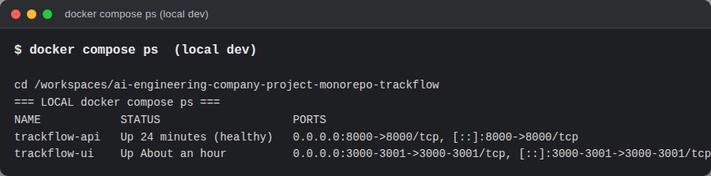
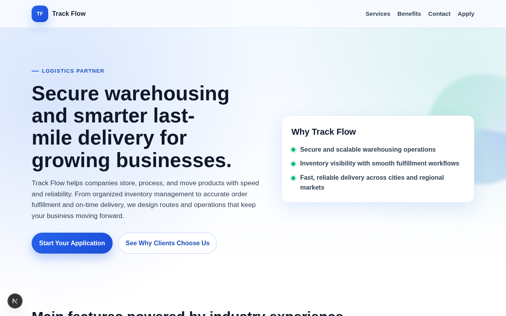
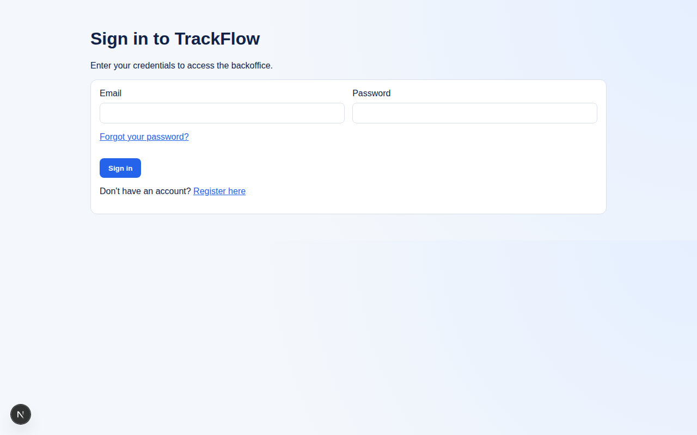
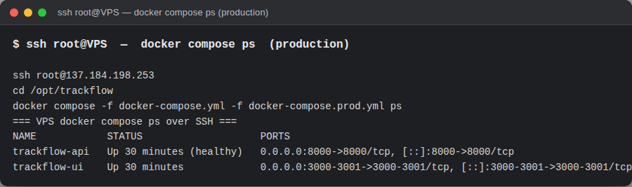
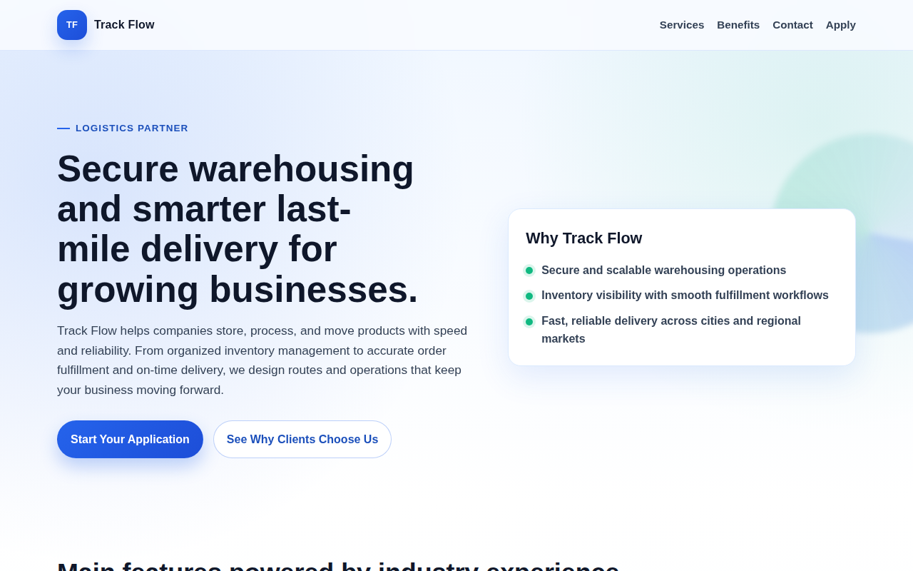
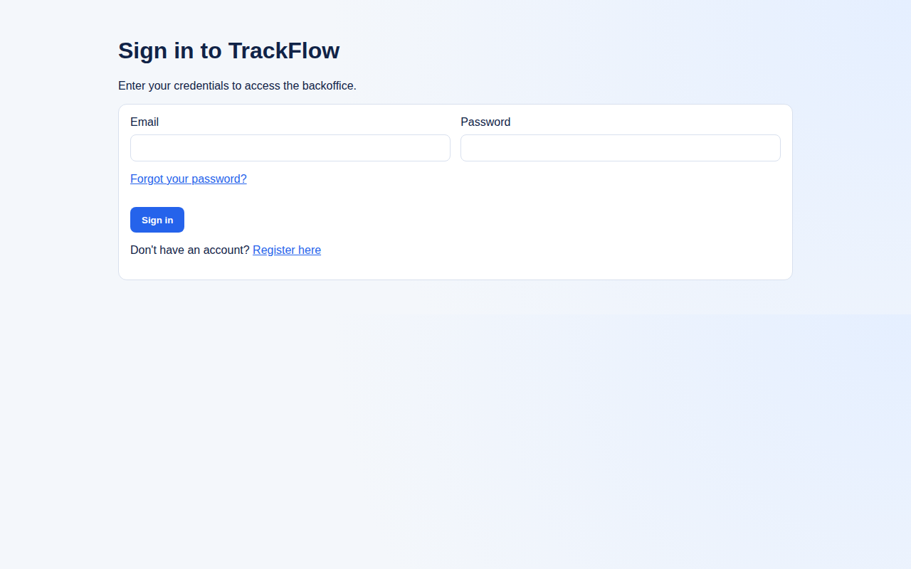

# INFRA-40 — Docker deployment evidence

Live evidence captured from the running stacks on **2026-10-30**.

## Local development (hot reload)

`docker compose up` from the repo root (auto-loads `docker-compose.override.yml` —
bind-mounts + `UVICORN_RELOAD=true` + `TRACKFLOW_UI_MODE=dev`).

| App | URL |
|-----|-----|
| Public website | http://localhost:3000 |
| Backoffice | http://localhost:3001 |
| API health | http://localhost:8000/health |

## VPS production (137.184.198.253)

Deployed with the prod overlay (self-contained images, **no bind-mounts**):
`docker compose -f docker-compose.yml -f docker-compose.prod.yml up -d --build`

| App | URL |
|-----|-----|
| Public website | http://137.184.198.253:3000 |
| Backoffice | http://137.184.198.253:3001 |
| API health | http://137.184.198.253:8000/health |

## Requirements checklist

- [x] Both frontends run from a **single UI container** (`trackflow-ui` runs
      website `:3000` + backoffice `:3001` via `uis/start.sh`).
- [x] FastAPI runs in its **own container** (`trackflow-api`, `:8000`).
- [x] Hot reloading: local dev = `next dev` + uvicorn `--reload` (override).
- [x] Configuration from **environment variables** (root `.env`, git-ignored).
- [x] Inter-service communication **by Docker service name**
      (`BACKEND_UPSTREAM=http://api:8000`), never `localhost`.